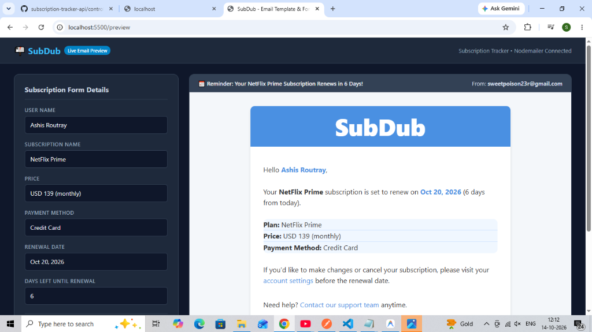

# 📬 SubDub — Subscription Tracker & Automated Reminder API


> **Never miss a subscription renewal again.**  
> A production-ready SaaS REST API built with Node.js, Express, MongoDB, and Upstash Workflows that automates multi-stage email reminders before subscriptions expire, fortified with Arcjet security and JWT authentication.

<p align="center">
  
</p>

---

## ✨ Features

- **🔄 Automated Workflow Reminders:** Uses **Upstash Workflows & QStash** to orchestrate durable delays and trigger automated email reminders (7, 5, 2, and 1 day before renewal) without heavy cron server overhead.
- **🛡️ Enterprise-Grade Security:** Protected by **Arcjet** with bot detection, rate limiting, and attack shielding.
- **🔐 JWT Authentication:** Secure user signup, login, session validation, and password hashing via `bcryptjs`.
- **📊 Subscription Lifecycle Management:** Full CRUD operations with auto-calculated renewal dates, auto-expiration, and status tracking (active, cancelled, expired).
- **📧 Nodemailer Integration:** Dynamic HTML email templates personalized with user name, plan details, price, and days remaining.
- **🎨 Live Email Preview & Tester:** Built-in interactive browser page at `/preview` to visually test, tweak, and send test reminder emails directly to your inbox.

---

## 🛠️ Tech Stack

| Technology | Purpose |
| :--- | :--- |
| **Node.js & Express** | Modern backend runtime & RESTful routing (ES Modules) |
| **MongoDB & Mongoose** | NoSQL database with pre-save hooks and schema validation |
| **Upstash Workflow & QStash** | Durable background workflow orchestration and scheduling |
| **Arcjet** | Bot defense, rate limiting, and request shielding |
| **Nodemailer** | Transactional email delivery service |
| **Day.js** | Date arithmetic and renewal date calculation |
| **JSON Web Tokens (JWT)** | Stateless authentication with HTTP-only cookies |

---

## 📁 Project Structure

```bash
subscription-tracker/
├── config/             # Environment, Nodemailer, Arcjet, and Upstash configurations
├── controllers/        # Request controllers (auth, user, subscription, workflow)
├── database/           # MongoDB connection logic
├── middlewares/        # Auth, Arcjet security, and global error handlers
├── models/             # Mongoose schemas (User, Subscription)
├── routes/             # Express API route declarations
├── utils/              # Email templates and email sender utilities
├── app.js              # Express app entry point
└── package.json        # Project metadata and dependencies
```

---

## 🚀 Getting Started

### 1. Prerequisites
- [Node.js](https://nodejs.org/) (v18+)
- [MongoDB Atlas](https://www.mongodb.com/atlas) account or local MongoDB instance
- [Upstash](https://upstash.com/) account (or local `@upstash/qstash-cli`)
- [Arcjet](https://arcjet.com/) account for API security keys

### 2. Clone the Repository
```bash
git clone https://github.com/<YOUR_USERNAME>/subscription-tracker-api.git
cd subscription-tracker-api
```

### 3. Install Dependencies
```bash
npm install
```

### 4. Configure Environment Variables
Create a `.env.development.local` file in the root directory:

```env
PORT=5500
SERVER_URL="http://localhost:5500"
NODE_ENV=development

# Database
DB_URI="mongodb+srv://<username>:<password>@cluster0.mongodb.net/subscription-tracker?retryWrites=true&w=majority"

# JWT
JWT_SECRET="your_jwt_secret_key"
JWT_EXPIRES_IN="1d"

# Arcjet Security
ARCJET_KEY="your_arcjet_api_key"
ARCJET_ENV="development"

# Upstash QStash (Local Development)
QSTASH_URL=http://127.0.0.1:8080
QSTASH_TOKEN=your_token
QSTASH_CURRENT_SIGNING_KEY=your_current_signing_key
QSTASH_NEXT_SIGNING_KEY=your_next_signing_key

# Nodemailer
EMAIL_PASSWORD="your_gmail_app_password"
```

### 5. Run the Application

#### Terminal 1: Start the API Server
```bash
npm run dev
```

#### Terminal 2: Start Upstash Local Dev Server
```bash
npx @upstash/qstash-cli dev
```

Your API is now live at `http://localhost:5500`!

---

## 📬 Interactive Email Preview

Open your browser to visually inspect and test email templates in real time:

- **Interactive Tester:** [http://localhost:5500/preview](http://localhost:5500/preview)
- **Raw HTML Email:** [http://localhost:5500/preview/raw](http://localhost:5500/preview/raw)

---

## 🔌 API Endpoints

### 🔐 Authentication (`/api/v1/auth`)
| Method | Endpoint | Description |
| :--- | :--- | :--- |
| `POST` | `/api/v1/auth/sign-up` | Register a new user |
| `POST` | `/api/v1/auth/sign-in` | Authenticate user and receive JWT token |
| `POST` | `/api/v1/auth/sign-out` | Log out and invalidate cookie |

### 💳 Subscriptions (`/api/v1/subscriptions`)
| Method | Endpoint | Description | Auth Required |
| :--- | :--- | :--- | :--- |
| `POST` | `/api/v1/subscriptions` | Create subscription & trigger Upstash workflow | Yes |
| `GET` | `/api/v1/subscriptions` | Get all subscriptions for authenticated user | Yes |
| `GET` | `/api/v1/subscriptions/:id` | Get subscription details by ID | Yes |
| `PUT` | `/api/v1/subscriptions/:id` | Update subscription details | Yes |
| `DELETE` | `/api/v1/subscriptions/:id` | Delete a subscription | Yes |
| `PUT` | `/api/v1/subscriptions/:id/cancel` | Cancel an active subscription | Yes |
| `GET` | `/api/v1/subscriptions/upcoming-renewals` | Fetch subscriptions renewing within 7 days | Yes |

### ⚡ Workflows (`/api/v1/workflows`)
| Method | Endpoint | Description |
| :--- | :--- | :--- |
| `POST` | `/api/v1/workflows/subscription/reminder` | Upstash automated background reminder runner |

---

## 🛡️ Security Features
- **Arcjet Bot Shield:** Filters malicious bots and automated scraping tools.
- **Sliding-Window Rate Limiting:** Throttles burst requests to prevent brute force and DDoS.
- **Mongoose Validation:** Validates start dates, prevents invalid renewal intervals, and sanitizes payloads.

---

## 👤 Author
- **Ashis Routray**  
- GitHub: [@AshisRoutray](https://github.com/AshisRoutray)

---

## 📝 License
This project is licensed under the ISC License.
